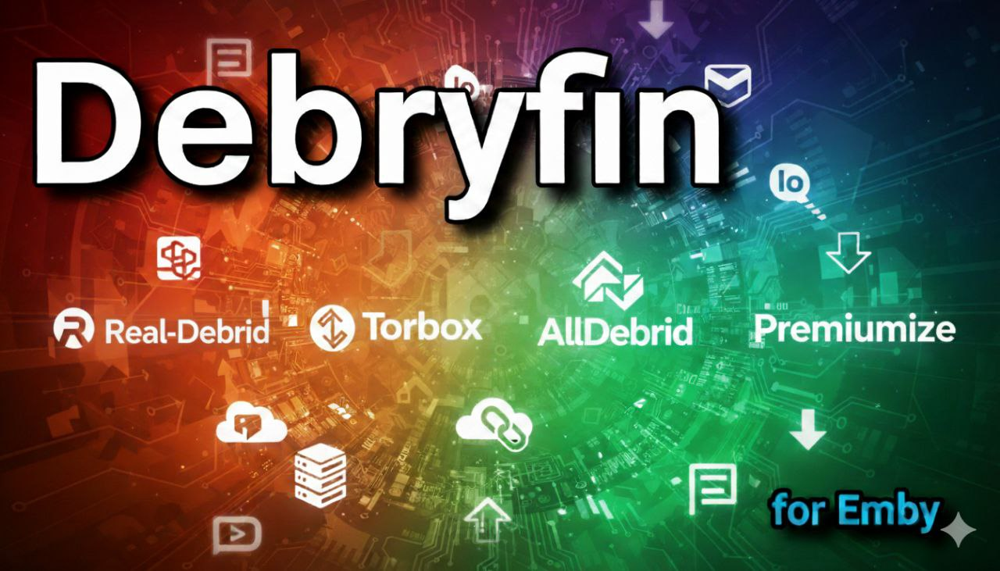

# Debryfin

<p align="center">
  
</p>

<p align="center">
  <a href="https://www.gnu.org/licenses/gpl-3.0"></a>
  <a href="https://github.com/Johanst21/Debryfin/releases/tag/v1.6.0.0"></a>
</p>

Emby Server plugin that resolves .strm links to direct streaming URLs using Real-Debrid, AllDebrid, TorBox, and Premiumize with automatic fallback.

**Status:** Version `v1.6.0.0`.

## Features
* **Debrid Resolution:** Resolves `.strm` links to direct, high-speed playback URLs using Debrid providers.
* **Supported Providers:** Support for Real-Debrid, AllDebrid, TorBox, and Premiumize.
* **Automatic Provider Fallback:** If the primary configured provider fails or cannot resolve a link, Debryfin automatically attempts resolution with the next configured provider.
* **URL Caching:** Built-in caching of resolved streaming URLs to reduce API requests and latency.
* **Automatic Refresh:** Automatically refreshes stream links when expired.
* **Configurable Credentials:** Clean and intuitive plugin settings UI allowing easy configuration of per-provider API keys and fallback options.

## Requirements
* **Emby Server:** Requires Emby Server 4.10 or newer. For Emby 4.9, use release v1.2.0.0.
* **Debrid Account:** Active Real-Debrid, AllDebrid, TorBox or Premiumize account with an API key/token.
* **.NET SDK:** 8.0 or higher (for compilation).
* **Target Framework:** `netstandard2.0`.

## Compilation
To build the plugin in Release mode:
```bash
dotnet restore
dotnet build -c Release
```
The generated library will be located at:
```
bin/Release/netstandard2.0/Debryfin.dll
```

## Installation
1. Stop the Emby server.
2. Copy the generated `Debryfin.dll` into the Emby plugins directory:
   * **Linux**: `/var/lib/emby/plugins/` (or your Emby profile path).
   * **Windows**: `%AppData%\Emby-Server\programdata\plugins\`
3. Start Emby Server.
4. Go to **Emby Admin Dashboard > Plugins** to configure your Debrid provider API keys.

## Releases
* **Debryfin Releases**: https://github.com/Johanst21/Debryfin/releases
Pre-compiled binaries (`Debryfin.dll`) are attached as release assets.

## License
This project is licensed under the terms of the GNU General Public License v3.0 (GPL-3.0). See the [LICENSE](LICENSE) file for the full license text.

## Disclaimer
This plugin interacts with third-party services (Real-Debrid, AllDebrid). Users are responsible for complying with the respective Terms of Service of each provider.
